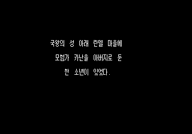
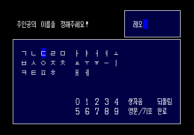
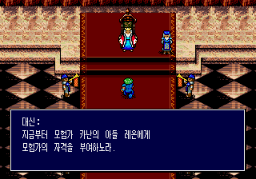
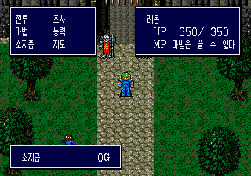

# 소서 킹덤 한국어 패치

메가드라이브 일본판 《소서 킹덤》(ソーサルキングダム)용 비공식 한국어 패치입니다. 현재 배포 버전은 v1.0.0 정식판입니다.

## 다운로드

[패치 다운로드](https://github.com/kilk96/sorcer-kingdom-korean-patch/releases/tag/v1.0.0)에서 `SorcerKingdom_ko_v1.0.0.zip`을 받아 압축을 풀어 주세요. 페이지의 Assets(첨부 파일)에서 찾을 수 있습니다.

`Source code` 압축 파일은 받지 않으셔도 됩니다. 원본 게임 파일과 패치 적용이 끝난 게임 파일은 제공하지 않습니다.

## 적용 방법

1. 직접 보유하신 일본판 원본을 백업하고, 아래 지원 원본과 파일 확인의 크기·SHA-256을 확인해 주세요.
2. xdelta 3.2 이상을 지원하는 패치 프로그램에서 원본 파일과 `SorcerKingdom_ko_v1.0.0.xdelta`를 선택해 주세요.
3. 결과를 원본과 다른 이름의 `.md` 파일로 저장하고 아래 결과 SHA-256과 비교해 주세요.
4. 결과 파일을 메가드라이브 에뮬레이터에서 실행해 주세요. 자세한 명령은 ZIP 안의 `README.md`에 있습니다.

## 한글판 화면





한글 이름 입력 화면에서 ‘레오’를 조합하는 모습입니다. 선택한 글자와 다음 입력 칸에 파란 커서가 켜져 있습니다.





## 번역·확인 범위

- 오프닝 서사와 컷신, 마을·던전·이벤트의 대사를 한글로 바꾸었습니다.
- 캠프 메뉴, 장비·아이템·마법·동료 이름과 설명, 상점·여관, 전투 메시지, 직업 칭호, 지도의 지역명, 저장 화면을 한글로 바꾸었습니다.
- 주인공 이름을 한글 최대 8글자로 지을 수 있고, 이름 뒤 조사(을/를, 이/가 등)는 받침에 맞게 바뀝니다.
- 원래 영문 라벨(`HP`, `MP`, `G`, `NEW GAME` 등), 영문 엔딩 스태프 롤·사운드 테스트, 그림으로 그려진 타이틀 로고는 원본 그대로 두었습니다.
- 제작자가 한글판으로 엔딩까지 플레이해 확인했습니다. 엔딩 확인 뒤 추가한 파란 커서는 새 게임에서 이름 입력부터 오프닝 진입까지 확인했습니다. 
- 고르지 않은 대화 분기나 선택하지 않은 장면은 직접 확인하지 못했습니다.

## 실행과 저장

확인한 환경은 BizHawk 2.11.1의 GPGX 코어입니다. 패치를 적용하면 파일 크기가 1MB에서 2MB로 늘어납니다. 게임 안 저장은 한글판에서 저장·불러오기를 확인했으며, 일본판에서 만든 저장을 불러오는 경우는 확인하지 않았습니다. 에뮬레이터의 순간 저장(세이브스테이트)은 일본판과 한글판 사이에, 또 패치 버전 사이에 호환되지 않습니다.

## 알려진 제한

- 실제 기기와 다른 에뮬레이터는 확인하지 못했습니다.
- 상점 품목 목록 스크롤이 원본보다 1프레임(약 1/60초) 늦습니다. 상태 상세·전투·이름 입력 등 일부 창은 표시 속도를 원본과 따로 재지 않았으나, 엔딩까지의 플레이에서 느리다고 느낀 곳은 없었습니다.
- 마지막 전투에서 공격이 전혀 맞지 않는다면 원본 게임의 명중 규칙 때문입니다. 레벨을 더 올려 주세요.

## 지원 원본과 파일 확인

| 항목 | 값 |
|---|---|
| 기종·판본 | 메가드라이브, Sorcer Kingdom (Japan) |
| 원본 형식 | 헤더 없는 롬(`.md` 또는 `.bin`) |
| 원본 크기 | 1,048,576바이트 |
| 원본 SHA-256 | `63d99751e0a5212f8a82f3e6a7885f0780a286d961db798fc032fb784e8a8b65` |
| 결과 크기 | 2,097,152바이트 |
| 결과 SHA-256 | `8e1f90763d51271b52927138a31af011a57960d23e05d382556810d7bb28cdc3` |

SHA-256은 파일 내용이 같은지 확인하는 값입니다. 파일명보다 크기와 이 값이 일치하는지 확인해 주세요.

Windows PowerShell에서 다음 명령의 파일명을 바꾸어 원본과 결과를 각각 확인하실 수 있습니다.

```powershell
Get-FileHash -Algorithm SHA256 -LiteralPath '확인할파일.md'
```

## 문제 제보

[Issues에 제보해 주세요](https://github.com/kilk96/sorcer-kingdom-korean-patch/issues). 패치 버전, 에뮬레이터 이름·버전, 발생 장소와 직전 조작, 문제 화면을 함께 적어 주시면 도움이 됩니다. 원본·패치 적용 완료 게임 파일은 첨부하지 말아 주세요.

## 권리와 글꼴

원작사와 관계없는 팬 번역이며, 게임의 권리는 각 권리자에게 있습니다. 한글 글꼴은 갈무리11 Condensed 글꼴(SIL Open Font License 1.1)을 게임용 비트맵으로 변환해 사용했으며, ZIP 안에 `FONT-NOTICE.txt`와 `LICENSE-Galmuri.txt`를 함께 넣었습니다.
